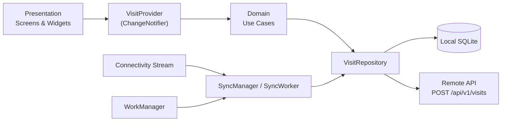
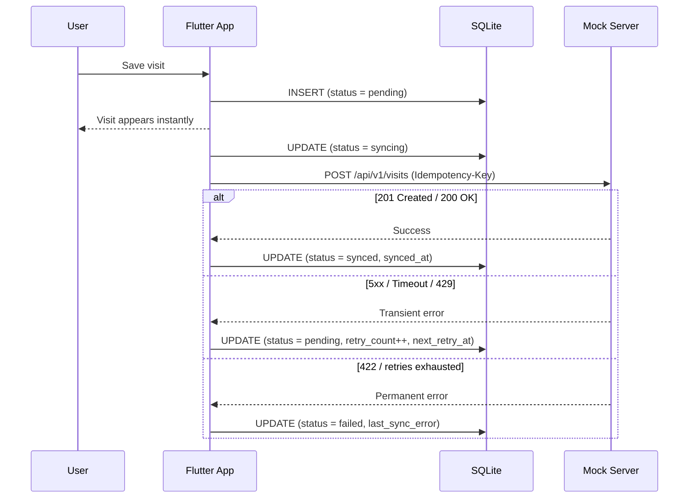
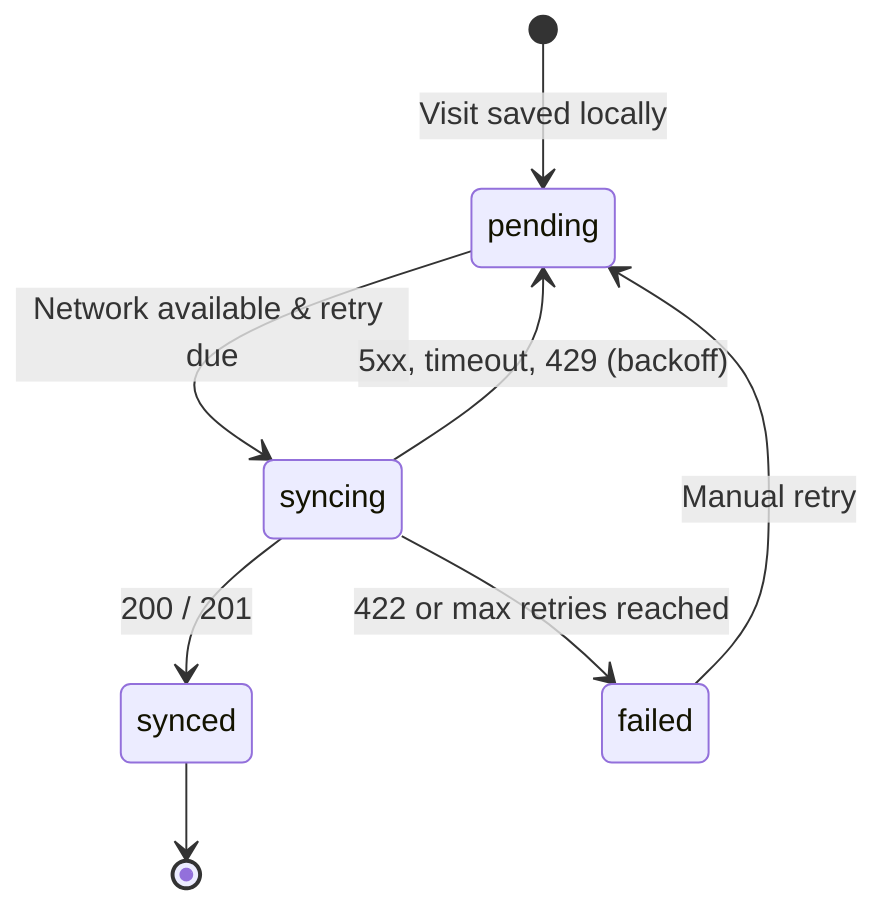

<div align="center">

# 📋 Field Visit Log

**A professional Android application for field employees to log customer visits offline-first, with automatic background synchronisation when connectivity returns.**


[Quick Start](#-quick-start-guide-run-in-2-steps) •
[Features](#-key-features) •
[Architecture](#-architecture--clean-layering) •
[API](#-api-contract--idempotency) •
[Testing](#-automated-test-suite) •
[Troubleshooting](#-troubleshooting)

</div>

---

## 📑 Table of Contents

1. [App Screenshots](#-app-screenshots)
2. [Key Features](#-key-features)
3. [Tech Stack](#-tech-stack)
4. [Quick Start Guide](#-quick-start-guide-run-in-2-steps)
5. [How to Test Offline-First Resilience](#-how-to-test-offline-first-resilience)
6. [Prerequisites](#-prerequisites)
7. [Simulating Server Errors & Edge Cases](#️-simulating-server-errors--edge-cases)
8. [Architecture & Clean Layering](#️-architecture--clean-layering)
9. [Sync Flow & Status Lifecycle](#-sync-flow--status-lifecycle)
10. [Database Schema](#️-database-schema)
11. [API Contract & Idempotency](#-api-contract--idempotency)
12. [Retry Policy & Exponential Backoff](#-retry-policy--exponential-backoff)
13. [Permissions & Security](#-permissions--security)
14. [Automated Test Suite](#-automated-test-suite)
15. [Troubleshooting](#-troubleshooting)
16. [Assumptions & Limitations](#-assumptions--limitations)
17. [Technical Note](#-technical-note-decisions-trade-offs--next-steps)

---

## 📱 App Screenshots

| 1. Visit List | 2. Add Visit Form | 3. Visit Details |
| :---: | :---: | :---: |
|  |  |  |
| *Real-time sync summary, status badges & filters* | *Offline-first form, validation & photo capture* | *Detailed metadata, sync audit & retry controls* |

---

## ✨ Key Features

| Feature | Description |
|---------|-------------|
| 📴 **Offline-first** | Every visit is written to local SQLite first; the UI never waits on network latency. |
| 🔄 **Automatic sync** | Foreground sync on network return plus headless WorkManager background workers. |
| 🛡️ **Idempotent uploads** | A stable client UUID is reused as the `Idempotency-Key`, so retries never create duplicates. |
| ⏱️ **Smart retries** | Exponential backoff (10 s → 30 min, up to 5 attempts) with `Retry-After` support for rate limits. |
| 📷 **Photo capture** | Optional in-app camera or gallery selection, requested only when the user taps. |
| 🏷️ **Status tracking** | Clear `Pending` / `Syncing` / `Synced` / `Failed` badges, filters, and a per-visit sync audit. |
| 🔒 **Privacy-aware** | Customer names, notes, and photos are never written to console logs. |
| 🌐 **Multi-platform dev** | Runs on Android emulator, physical phone, or Google Chrome with zero extra setup. |

---

## 🧰 Tech Stack

| Layer | Technology |
|-------|------------|
| **UI Framework** | Flutter (Dart) |
| **State Management** | Provider (`ChangeNotifier`) |
| **Local Storage** | SQLite (`sqflite`, IndexedDB on web) |
| **Background Work** | WorkManager + connectivity stream |
| **Networking** | REST over HTTP (`ApiClient`) |
| **Mock Backend** | Node.js (`mock_server`) with JSON file persistence |
| **Testing** | Unit, widget, and integration tests (`sqflite_common_ffi` for desktop/CI) |

---

## ⚡ Quick Start Guide (Run in 2 Steps)

You need **two terminal windows**: one for the mock server, and one for the Flutter app.

### Step 1: Start the Mock Server (Terminal 1)
```bash
cd mock_server
npm install
npm start
```
> The mock server will run on `http://localhost:3001` and save data to `mock_server/data/visits.json`. Keep this terminal window open!

---

### Step 2: Run the App (Terminal 2)

Choose whichever method is most convenient for you:

#### 🌐 Option A: In Google Chrome (Fastest & Zero Setup — Recommended!)
```bash
flutter run -d chrome
```
*No emulator or phone needed. Runs immediately with persistent IndexedDB and full camera/gallery support.*

#### 📱 Option B: In Android Studio Emulator
```bash
flutter run
```
*The app automatically connects to the mock server at `http://10.0.2.2:3001` with zero configuration.*

#### 📲 Option C: On a Physical Android Phone
1. Install and run the app:
   ```bash
   flutter run
   # OR build debug APK: flutter build apk --debug
   # APK location: build/app/outputs/flutter-apk/app-debug.apk
   ```
2. **Connect the phone to the server**:
   * **Via Wi-Fi (No cables)**: Connect your phone to the same Wi-Fi as your computer. In the app header, **tap the `Online / Offline` pill**, enter your computer's local Wi-Fi IP (e.g. `http://192.168.1.15:3001`), and tap **Save & Sync**.
   * **Via USB Cable**: Plug in your phone with USB Debugging enabled, run `adb reverse tcp:3001 tcp:3001`, tap the `Online / Offline` pill, and pick **Localhost / USB**.

#### 🧭 Which option should I pick?

| Option | Setup effort | Best for |
|--------|:------------:|----------|
| **A – Chrome** | ⭐ Minimal | Quick demo and UI review |
| **B – Emulator** | ⭐⭐ Moderate | Realistic Android behaviour |
| **C – Physical phone** | ⭐⭐⭐ Highest | Real-world connectivity and camera testing |

---

## 🧪 How to Test Offline-First Resilience

1. **Online Creation**: Add a visit with the mock server running. The visit saves to SQLite and syncs immediately (`Synced`).
2. **Offline Creation**: Stop the mock server (`Ctrl + C` in Terminal 1) or disable Wi-Fi. Add a visit. It saves to local SQLite instantly (`Pending`).
3. **App Restart**: Close and relaunch the app. All visits reload intact from local storage.
4. **Auto-Sync on Reconnect**: Restart the server (`npm start`) or reconnect Wi-Fi. All pending visits automatically synchronize and update to `Synced`!

---

## 🔧 Prerequisites

| Tool              | Version      | Purpose                          |
|-------------------|-------------|----------------------------------|
| Flutter           | ≥ 3.10.0    | UI and Application Framework     |
| Dart              | ≥ 3.0.0     | Programming Language             |
| Android SDK       | API 21+     | Mobile Target                    |
| Node.js           | ≥ 18.x      | Mock Server Execution            |

---

## 🛠️ Simulating Server Errors & Edge Cases

In the `mock_server` directory:
```bash
# Simulate a 500 server error on every 3rd request
SERVER_ERROR_EVERY=3 npm start

# Simulate a 429 rate limit with Retry-After header on every 5th request
RATE_LIMIT_EVERY=5 npm start
```

| Environment Variable | Simulated Behaviour | Expected App Reaction |
|----------------------|---------------------|-----------------------|
| `SERVER_ERROR_EVERY=3` | HTTP `500` on every 3rd request | Transient error → exponential backoff retry |
| `RATE_LIMIT_EVERY=5` | HTTP `429` + `Retry-After` on every 5th request | Waits for the `Retry-After` duration, then retries |

---

## 🏛️ Architecture & Clean Layering

```
UI → Provider (ChangeNotifier) → Use Cases → Repository → Local SQLite
                                                        ↘ Remote API (POST /api/v1/visits)
```

- **Offline-first:** SQLite writes always happen first; the UI never waits on network latency.
- **Single State Management:** Standard Provider with `ChangeNotifier`.
- **Repository Pattern:** Pure domain interfaces isolated from data and framework layers.
- **WorkManager & Connectivity Stream:** Multi-layer synchronization (foreground on reconnect + headless background workers).



### Project Folder Structure

```
lib/
├── core/          # AppConstants, typed AppException, ApiClient, AppDatabase, theme, validators
├── features/
│   └── visits/
│       ├── data/         # VisitModel, VisitLocalDatasource, VisitRemoteDatasource, VisitRepositoryImpl
│       ├── domain/       # Visit entity, VisitRepository interface, 4 focused use cases
│       └── presentation/ # Screens (List, Add, Details), Widgets, VisitProvider
├── sync/          # SyncManager, SyncWorker, RetryPolicy, SyncStatus
├── routing/       # AppRouter
├── app.dart       # App initialization and theme setup
└── main.dart      # Entry point with WorkManager initialization
```

---

## 🔁 Sync Flow & Status Lifecycle

### Sequence of a Single Visit Upload



### Sync Status State Machine



---

## 🗄️ Database Schema

SQLite Table: `visits`

| Column           | Type    | Description                                             |
|------------------|---------|---------------------------------------------------------|
| `id`             | TEXT PK | Stable client UUID (reused as Idempotency-Key)          |
| `customer_name`  | TEXT    | Required, 2–80 characters                               |
| `notes`          | TEXT    | Required, 5–500 characters                              |
| `created_at`     | TEXT    | UTC ISO-8601 creation timestamp                         |
| `photo_path`     | TEXT?   | Local file path or base64 photo data (nullable)        |
| `sync_status`    | TEXT    | `pending` / `syncing` / `synced` / `failed`             |
| `retry_count`    | INTEGER | Number of attempted synchronizations                    |
| `next_retry_at`  | TEXT?   | UTC timestamp indicating next eligible retry time       |
| `last_sync_error`| TEXT?   | Sanitized, user-friendly error message                  |
| `synced_at`      | TEXT?   | UTC confirmation timestamp from server                  |

*All timestamps are stored internally in UTC and displayed formatted in local time.*

---

## 📡 API Contract & Idempotency

```http
POST /api/v1/visits
Content-Type: application/json
Idempotency-Key: <clientVisitId>

{
  "clientVisitId": "uuid-v4",
  "customerName": "Jane Doe",
  "notes": "Visited and reviewed contract terms...",
  "visitedAt": "2026-01-15T10:00:00.000Z",
  "photoReference": null
}
```

* **201 Created**: Successful first-time upload (`status: synced`).
* **200 OK**: Duplicate idempotent request; server returns existing record without duplicating.
* **422 Unprocessable Entity**: Validation failure (exhausts retries immediately).
* **429 Too Many Requests**: Rate limiting (respects `Retry-After` header).
* **5xx / Timeout**: Transient error (triggers exponential backoff retry).
* **401 Unauthorized**: Authentication failure (stops retrying).

### Response Handling Summary

| HTTP Status | Meaning | App Behaviour | Retry? |
|:-----------:|---------|---------------|:------:|
| `201` | Created | Mark `synced` | — |
| `200` | Duplicate (idempotent) | Mark `synced`, no duplicate created | — |
| `401` | Unauthorized | Stop retrying | ❌ |
| `422` | Validation failure | Exhaust retries immediately, mark `failed` | ❌ |
| `429` | Rate limited | Wait for `Retry-After` | ✅ |
| `5xx` / timeout | Transient error | Exponential backoff | ✅ |

---

## 🔁 Retry Policy & Exponential Backoff

- **Initial delay:** 10 seconds.
- **Multiplier:** 2.0× exponential backoff.
- **Max retry delay:** 30 minutes.
- **Max retries:** 5 attempts.
- **Duplicate Prevention:** The same client UUID is preserved across all retries and transmitted in the `Idempotency-Key` header.

| Attempt | Delay Before Retry |
|:-------:|:------------------:|
| 1 | 10 s |
| 2 | 20 s |
| 3 | 40 s |
| 4 | 80 s |
| 5 | 160 s |

*Delays are capped at 30 minutes. A `Retry-After` header on a `429` response takes precedence.*

---

## 🔒 Permissions & Security

| Permission           | Triggered               | Justification                     |
|----------------------|-------------------------|-----------------------------------|
| `INTERNET`           | App launch              | REST API synchronization          |
| `CAMERA`             | Only upon user tap      | Optional in-app photo capture     |
| `READ_MEDIA_IMAGES`  | Only upon user tap      | Optional gallery photo selection  |

- Customer names, notes, and photos are **strictly excluded from all console logs**.
- SQL queries use **parameterized statements** to prevent injection.
- Zero credentials or API keys are committed.

### Production Note: Authentication Tokens & Photo Storage
- **Authentication Tokens**: In a production environment, user credentials should be stored securely using `flutter_secure_storage` (backed by Android Keystore and `EncryptedSharedPreferences`). API requests would transmit short-lived JWTs via `Authorization: Bearer <token>` headers with automatic refresh token rotation. If the server responds with `401 Unauthorized`, cached tokens are cleared and the user is guided to sign in again without losing any unsynced local drafts.
- **Photo Storage**: Photos should be compressed (e.g. WebP/JPEG) and uploaded asynchronously to cloud object storage (AWS S3, Google Cloud Storage, or Cloudinary) using pre-signed upload URLs. Only the returned immutable asset reference key is stored in the local SQLite table and transmitted as `photoReference` in the visit sync payload, keeping the database lean and network payloads small.

---

## 🧪 Automated Test Suite

Run the full suite of **44 automated tests**:

```bash
# Run all unit, widget, and integration tests
flutter test

# Run device integration flow test
flutter test integration_test/app_flow_test.dart
```

---

## 🩺 Troubleshooting

| Problem | Likely Cause | Fix |
|---------|--------------|-----|
| Visits stay `Pending` | Mock server is not running or unreachable | Start it with `npm start` inside `mock_server/` and confirm `http://localhost:3001` responds. |
| Emulator cannot reach server | Wrong host address | The Android emulator uses `http://10.0.2.2:3001` to reach your computer's `localhost`. |
| Physical phone cannot reach server | Different network or wrong IP | Put the phone on the same Wi-Fi, then set your computer's local IP in the `Online / Offline` pill. |
| USB connection not working | Port not forwarded | Enable USB Debugging, run `adb reverse tcp:3001 tcp:3001`, then pick **Localhost / USB** in the app. |
| Port `3001` already in use | Another process is using the port | Stop the other process or free the port before running `npm start`. |
| Visit shows `Failed` | Validation error (`422`) or retries exhausted | Open the visit details to read the sync error, fix the data if needed, and use the retry control. |
| Background sync feels delayed | Android Doze / OEM battery optimisation | Keep the app in the foreground for immediate sync, or exempt it from battery optimisation. |

---

## 📋 Assumptions & Limitations

1. **Photo Upload**: The mock server validates JSON visits and preserves local photo attachments. Remote binary photo synchronization is kept separate to prioritize core visit reliability.
2. **WorkManager Battery Optimization**: On Android 12+, WorkManager execution can be deferred up to 15 minutes by Android Doze mode. Real-time foreground sync on network return compensates for active sessions.
3. **Authentication**: The mock API operates in development mode without OAuth tokens; production deployments should integrate JWT headers in `ApiClient`.

---

## 📝 Technical Note (Decisions, Trade-offs & Next Steps)

### What I Prioritised
**Reliable offline persistence** was the top priority. Every visit is written to SQLite before any network call is attempted. The UI returns immediately after the local write; the user sees their visit instantly regardless of connectivity. Idempotency was treated as a first-class concern: each visit receives a stable UUID at creation, and that same ID is sent as the `Idempotency-Key` header on every upload attempt. This ensures that retries after dropped connections or timeouts never create duplicate records on the server.

Clean layering came second — domain entities and use cases have zero Flutter UI or database dependencies, keeping business logic clean, isolated, and easily unit-testable.

### One Important Trade-off
**WorkManager vs. Foreground Sync**: WorkManager is the Android-recommended standard for guaranteed deferrable background work, but execution can be delayed 15+ minutes under aggressive OEM battery optimizations and Doze mode. The foreground connectivity listener fills this gap for active users by triggering an immediate sync pass the moment network returns. A permanent background service was intentionally avoided to respect battery life and eliminate persistent notification clutter.

### What I Would Improve With One Additional Day
1. **End-to-end integration test with a real SQLite database** — the current integration tests use `sqflite_common_ffi` (FFI-backed SQLite) which runs on desktop/CI without an emulator. I would add a dedicated automated test suite driving live Android emulator hardware directly.
2. **Photo upload** — the mock server currently accepts JSON payloads with `photoReference`. I would add multipart upload support and a separate `/api/v1/visits/{id}/photo` endpoint so photo data can be streamed independently of the JSON payload.
3. **Background sync visibility** — expose sync progress via a persistent foreground notification during an active sync pass so users on slow connections can see work is happening without opening the app.

---

<div align="center">

**Built with Flutter 💙 — offline-first, reliable, and idempotent by design.**

</div>